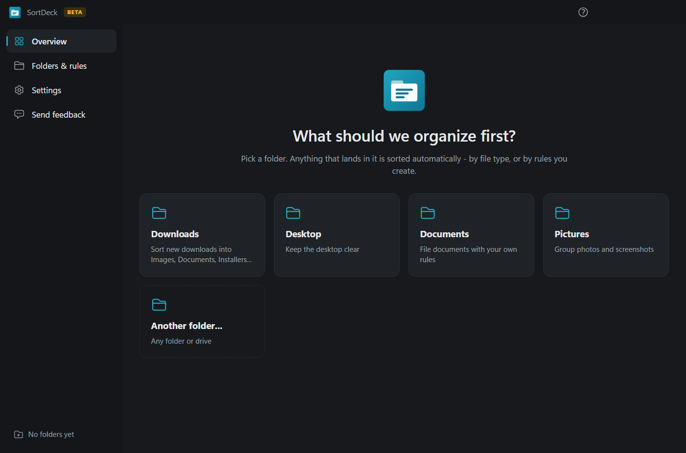
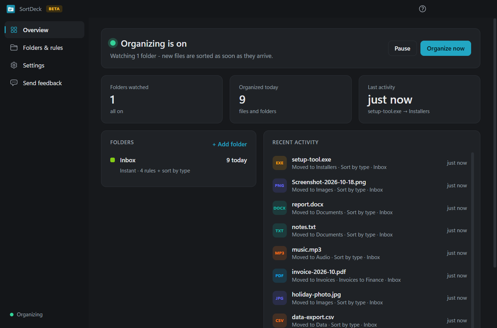
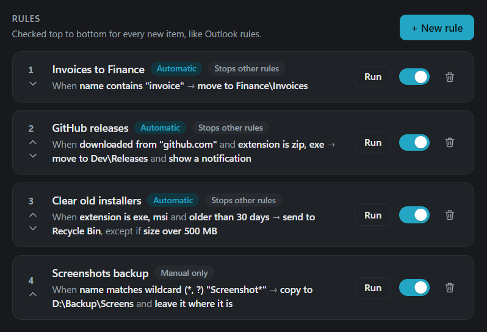
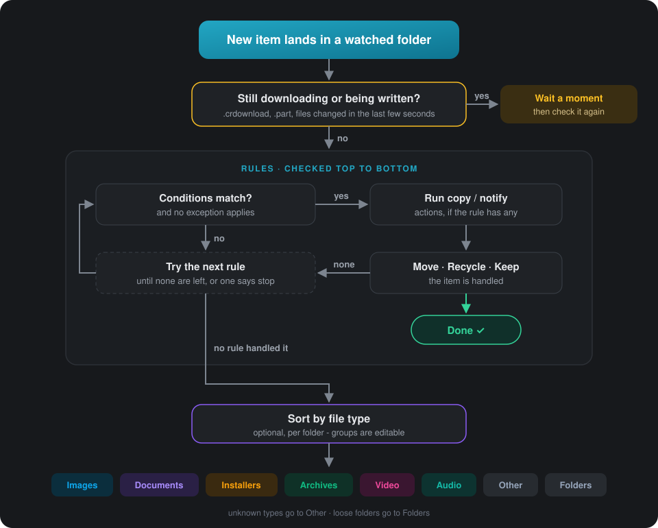

<div align="center">

```
███████╗ ██████╗ ██████╗ ████████╗██████╗ ███████╗ ██████╗██╗  ██╗
██╔════╝██╔═══██╗██╔══██╗╚══██╔══╝██╔══██╗██╔════╝██╔════╝██║ ██╔╝
███████╗██║   ██║██████╔╝   ██║   ██║  ██║█████╗  ██║     █████╔╝
╚════██║██║   ██║██╔══██╗   ██║   ██║  ██║██╔══╝  ██║     ██╔═██╗
███████║╚██████╔╝██║  ██║   ██║   ██████╔╝███████╗╚██████╗██║  ██╗
╚══════╝ ╚═════╝ ╚═╝  ╚═╝   ╚═╝   ╚═════╝ ╚══════╝ ╚═════╝╚═╝  ╚═╝
```

# SortDeck

### Outlook-style rules for your folders

Pick any folder. Everything that lands in it is filed the moment it arrives - by file type,
or by rules you build from name, size, age and even the website it came from.

<br>


<br>


<br>

[Screenshots](#screenshots) •
[Why SortDeck?](#why-sortdeck) •
[Install](#install) •
[Rules](#rules) •
[Examples](#example-rules) •
[How it works](#how-it-works) •
[Develop](#develop) •
[Versioning](#versioning) •
[Roadmap](#roadmap)

</div>

---

> [!WARNING]
> **SortDeck is in beta.** It's usable every day, but things may change between versions.
> Try it on one folder first, and use **Preview matches** before turning a new rule loose.
> Deleted items always go to the Recycle Bin, so nothing is lost for good.

## Screenshots

<div align="center">






</div>

## Why SortDeck?

| | |
| --- | --- |
| **Any folder, not just Downloads** | Desktop, Documents, a project folder, a USB drive - add as many as you like, each with its own rules. |
| **Rules you already understand** | Conditions, actions and exceptions, checked top to bottom - exactly like Outlook mail rules. |
| **Your schedule, per folder** | Organize *instantly* as items arrive, *every N minutes or hours*, or *only when you click* **Organize now** - with a preview first. |
| **Set up before anything moves** | New folders start in "set up rules first" mode: nothing is touched until you decide. |
| **Safe by default** | Unfinished downloads are skipped, files in use are retried, name clashes become `name (1).ext`, nothing is ever overwritten, and "delete" means the Recycle Bin. |
| **Set and forget** | Lives in the tray and starts with Windows. Close the window and it keeps working. |
| **Private** | Runs entirely on your PC. No account, no cloud, no telemetry. |

## Install

1. Download **`SortDeck-Setup-0.1.0-beta.2.exe`** from [Releases](https://github.com/Sammed-NJ/SortDeck/releases).
2. Double-click it. It installs in seconds - no admin prompt - and opens SortDeck.
3. Pick a folder and choose **Set up rules first** (nothing moves) or **Sort by file type right away**.
4. Add rules, hit **Organize now → Preview** to check them, then set **When to organize**:
   *Instantly*, *On a schedule* (every N minutes/hours) or *Only when I click*.

> Windows may say *"Windows protected your PC"* because beta builds aren't code-signed yet.
> Click **More info → Run anyway**.

Uninstall any time from **Settings → Apps**. Your files stay exactly where SortDeck put them.

## Rules

Each watched folder has its own list of rules, checked **top to bottom** for every new item.

| Part | Options |
| --- | --- |
| **When** | File name *contains / starts with / ends with / is exactly / matches wildcard / matches regex* · Extension *is / is not one of* · Size *larger / smaller than (MB)* · Age *older / newer than (minutes, hours, days)* · **Downloaded from** *website contains* · Item is a *file / folder* — match **all** or **any** |
| **Do this** | Move to folder · Copy to folder · Send to Recycle Bin · Leave it where it is · Show a notification (combine several) |
| **Except if** | Any of the same conditions |
| **Options** | On / off · Run automatically or manual-only · Stop processing more rules · Reorder |

- Destinations can be relative to the watched folder (`Finance\Invoices`) or any full path (`D:\Backup`).
- **Preview matches** shows exactly what a rule would do - without touching a file.
- **Organize now** runs the folder's rules (and sort by file type) once, on the folder or any subfolder,
  with a preview first. Each rule also has its own **Run** button.
- **When to organize** is set per folder: *Instantly* · *On a schedule* · *Only when I click* · *Off*.
- **Sort by file type** (optional, per folder) files whatever no rule handled into
  *Images, Documents, Installers, Archives, Data, Video, Audio* - all editable. Unknown types go to
  *Other*, loose folders to *Folders*.

> **"Downloaded from"** works because Windows records the source address of every browser
> download. Rules like *"everything from github.com → Dev\Releases"* just work.

## Example rules

| Rule | When | Do this | Except if |
| --- | --- | --- | --- |
| Invoices to Finance | name contains `invoice` | move to `Finance\Invoices` | extension is `zip` |
| GitHub releases | downloaded from `github.com` **and** extension is `zip, exe` | move to `Dev\Releases` + notify | |
| Clear old installers | extension is `exe, msi` **and** older than 30 days | send to Recycle Bin | size over 500 MB |
| Screenshot backup | name matches `Screenshot*` | copy to `D:\Backup\Screens` + leave in place | |
| Big files | size over 1000 MB | move to `Large` | item is a folder |

## How it works

<div align="center">

</div>

*Instant* folders also get a safety re-check every 30 seconds (configurable) to catch anything that was
locked; *scheduled* folders run on their own timer; *manual* folders are never touched until you click
**Organize now**. Quiet hours and **Pause** stop automatic organizing; manual runs still work.

Settings live in `%APPDATA%\SortDeck\config.json` and the activity log next to it.

## Develop

**Requirements:** Windows 10/11, [Node.js](https://nodejs.org) 20+.

```bat
git clone https://github.com/Sammed-NJ/SortDeck.git
cd SortDeck
npm install
npm start          :: run from source
npm test           :: engine + config tests
npm run dist       :: build dist\SortDeck-Setup-<version>.exe
```

> If `npm start` prints Node output instead of opening a window, your terminal has
> `ELECTRON_RUN_AS_NODE` set (VS Code's integrated terminal does). Run `set ELECTRON_RUN_AS_NODE=` first.

```
src/
  main/
    main.js      window, tray, start-with-Windows, IPC
    engine.js    watches folders, matches rules, moves / copies / recycles
    config.js    config shape, validation, load / save
  preload.js     the page's only bridge to the main process
  renderer/      the UI - app.js (overview, settings), folders.js, rules.js
tests/           engine.test.js, config.test.js  (plain node, no framework)
build/           app icon
docs/images/     screenshots
```

The engine has no Electron dependency, so its tests run against real temporary folders with plain `node`.
The page runs sandboxed with context isolation and a strict Content-Security-Policy; it can only reach
the main process through the small API in `preload.js`.

## Versioning

SortDeck follows [Semantic Versioning](https://semver.org). While in beta, versions look like
`0.y.z-beta.n`; every release is tagged in git (`v0.1.0-beta.1`) and listed in [CHANGELOG.md](CHANGELOG.md).

## Roadmap

- [ ] Code-signed installer (no SmartScreen warning)
- [ ] Automatic updates
- [ ] Undo for recent moves
- [ ] Rule templates gallery
- [ ] Conditions on file contents and dates in names
- [ ] macOS build

<div align="center">
<br>

**SortDeck** · made by [Sammed NJ](https://github.com/Sammed-NJ)

</div>
