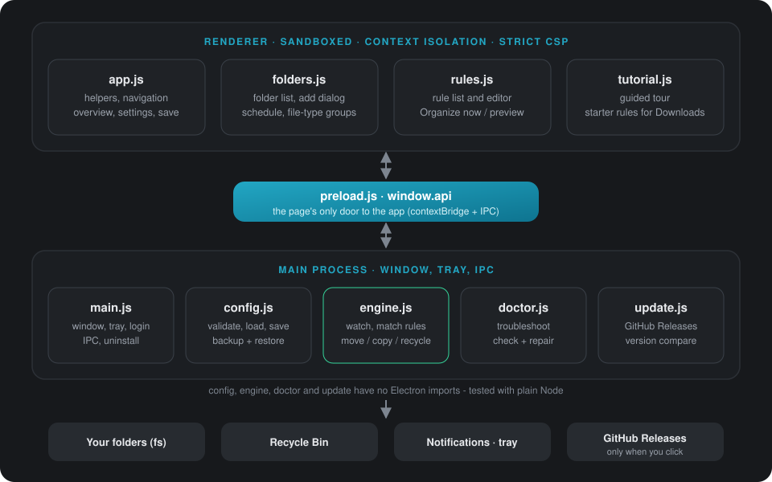
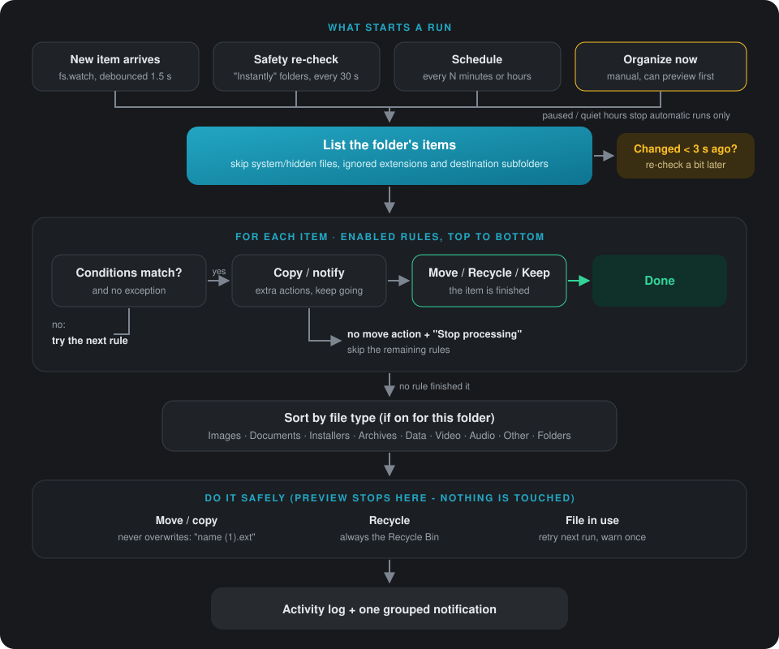

# Architecture

SortDeck is an Electron app with three layers: a sandboxed **renderer** (UI), a tiny **preload** bridge, and
the **main** process, which owns the window, the tray and the file-system engine.

<p align="center"></p>

## Files

| File | Role | Electron? |
| --- | --- | --- |
| `src/main/main.js` | App lifecycle, `BrowserWindow`, `Tray`, IPC, AppUserModelId | yes |
| `src/main/config.js` | Config schema, defaults, validation, atomic save | **no** |
| `src/main/engine.js` | `Organizer` class plus pure helpers (`matchRule`, `transfer`, ...) | **no** |
| `src/main/update.js` | Update check against GitHub Releases, version compare, trusted-URL check | **no** |
| `src/main/doctor.js` | Troubleshoot `check` / `repair` (app-specific checks injected) | **no** |
| `src/preload.js` | Exposes `window.api` - the renderer's only door | yes |
| `src/renderer/*` | Plain HTML/CSS/JS, no framework, no bundler | - |
| `tests/*.test.js` | Plain-node asserts against real temp folders | - |

`config.js` and `engine.js` have no Electron imports. Electron services (trash, notify) are injected into
`Organizer`, so the tests run with plain `node`.

## Data

**Config:** `%APPDATA%\SortDeck\config.json`.
- It is written atomically (first to `.tmp`, then renamed) and copied to `config.json.bak` after every save.
- On load, a damaged or missing file is restored from `.bak`. The damaged file is kept as `config.damaged.json`
  before anything overwrites it.

```js
{
  settings: { notifications, launchAtLogin, paused, trayHintShown,
              intervalSeconds /*5..3600*/, quietHours: {start,end} | null,
              theme: 'system'|'light'|'dark', accent: 'teal'|'blue'|'purple'|'green'|'orange'|'pink' },
  folders: [{
    id, path, enabled,
    trigger: 'instant' | 'interval' | 'manual',   // "Off" = enabled:false
    intervalMinutes /*1..10080*/,
    sortByType, categories: { Images: ['png', ...] },
    ignore: ['crdownload', ...], protected: ['Keep'],
    rules: [{ id, name, enabled, auto, match: 'all'|'any',
              conditions: [{field, op, value, unit?}], exceptions: [...],
              actions: [{type, dest?, message?}], stop }]
  }]
}
```

- The renderer edits a **form shape** (`toForm`), in which categories are a list and quiet hours are flat
  fields. `buildConfig` validates it and turns it back into the config shape.
- **Activity log:** `activity.json` sits next to the config and is capped at 500 entries.

## Engine flow

<p align="center"></p>

- **Manual runs** (`Organizer.run`) use the same `processItem`, skip the settle check, support `preview`
  (no side effects) and can target a subfolder. When a subfolder is targeted, the sort-by-type fallback is
  turned off.
- **Re-entrancy:** a busy folder that gets another event is marked `'again'` and swept once more afterwards.
- **Timers:** all of them are `unref()`'d, so tests and app quit are never held open.

## IPC surface (`window.api`)

| Call | Purpose |
| --- | --- |
| `getConfig` / `saveConfig(form)` | Load the form; validate and save it, then re-apply to the engine |
| `status` | Per-folder exists/error/today/nextRun, activity, totals |
| `previewTheme(theme)` | Sets `nativeTheme.themeSource` live while choosing; saved with the config |
| `pause(bool)` / `sweep()` | Tray-equivalent controls |
| `validateRule` / `runRules(folder, rules, target, preview, sortByType)` | Rule editor and Organize now |
| `suggestFolders` / `newFolder(path, opts)` / `pickFolder(base)` | Adding folders, picking destinations |
| `checkProblems` / `repairProblems` | Troubleshoot (`doctor.js`), also run once at startup |
| `checkUpdate` / `installUpdate` / `openReleases` | Update check. Install only uses the URL main found itself (github.com, https, this repo) |
| `uninstall(withData)` | Main shows the warning, then runs `Uninstall SortDeck.exe [--delete-app-data]` and quits |
| `openPath` (allow-listed) / `openConfigFile` / `info` / `onActivity` | Misc |

## Security
- Renderer: `contextIsolation`, `sandbox`, no `nodeIntegration`, strict CSP (`'self'` only).
- UI text is built with `h()` and `textContent`. Data never goes through `innerHTML`.
- `openPath` only opens paths inside watched folders or rule destinations.
- All config from the renderer is re-validated in main (`buildConfig`, `validateRule`).

## Tamper protection (installed build)
- App code ships inside `app.asar` with **embedded asar integrity validation**, set via `electronFuses` in
  `package.json`. An edited file means the app refuses to start.
- `onlyLoadAppFromAsar`: a loose `resources/app` folder is ignored.
- `runAsNode`, `NODE_OPTIONS` and `--inspect` are disabled. DevTools are off when `app.isPackaged`.
- The fix for a damaged install is to run the installer again, which keeps user data. Everything outside the
  install folder (config, log, shortcut, login item) is fixed by Troubleshoot.

## Build
`electron-builder --win` produces an NSIS one-click per-user installer:
`dist/SortDeck-Setup-beta.N.exe` for betas or `dist/SortDeck-Setup-vX.Y.Z.exe` for official releases (named by
`scripts/dist.js`; run it with `npm run dist`). The `appId` (`com.sortdeck.app`) must equal the AppUserModelId set in
`main.js`, or the taskbar shows the wrong icon. Dev runs use `com.sortdeck.app.dev`.
