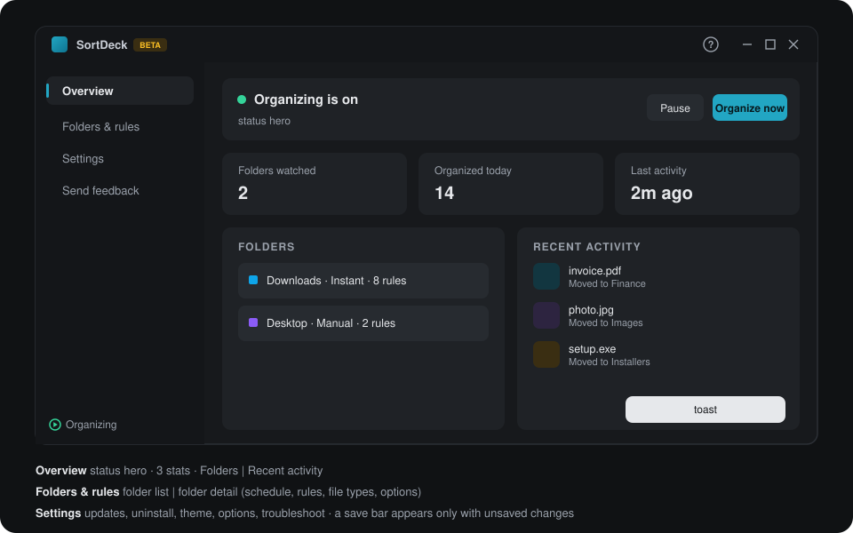

# Design

How SortDeck looks and behaves. The goal is that it feels like a native Windows 11 utility, explains
itself, and never surprises the user by moving files.

## Principles
1. **Nothing moves by surprise.** New folders start in "Set up rules first". Preview comes before every manual run.
2. **One rule language.** The UI uses *When / Do this / Except if*, "Stop processing more rules", top-to-bottom order.
3. **Plain words.** The UI says "Only when I click", not `trigger: manual`, and "Recycle Bin", not "delete".
4. **One save model.** All edits are collected in a form. The save bar shows *Unsaved changes* with Revert / Save (Ctrl+S).
5. **Quiet by default.** Notifications are grouped, there is a single tray hint, and a busy file is warned about once.

## Layout

**Folder detail, top to bottom:**
- header: name, path, Open, Remove, **Organize now...**
- **When to organize** card
- **Rules** list
- **Sort by file type** toggle and category rows
- **Folder options**: ignored extensions, protected subfolders

## Key flows

**Add folder**
1. Pick a suggestion or browse.
2. Choose a card: **Set up rules first** (default) or **Sort by file type right away**.
3. The folder is added. Nothing moves in setup mode.

**Create a rule**
1. Click *New rule* to open a dialog with Name, When (conditions + all/any), Do this (actions), Except if, Options.
2. Use *Preview matches* to list affected items.
3. Save.

**Guided tour** (starts by itself on first launch; replay with the **?** button in the title bar)
1. A welcome card offers **Start tour**, **Maybe later** (asks again next launch) or **Skip** (never auto-starts again).
2. Each step switches to the right page, dims the app and spotlights one element with a callout (Back / Next /
   Skip tour, "3 of 12"). The app can't be clicked while touring. Esc means "later"; the arrow keys move between steps.
3. Steps only appear when their element exists (folder steps need a folder).
4. The last step offers **Add starter rules**: Downloads is added in click-only mode with one rule per file type
   plus "Everything else to Other". Re-running it never duplicates rules.

**Organize now**
1. Open the dialog. It shows the rule list scope and an optional *Then sort the rest by file type* box.
2. Click **Preview**. A result list shows each item → action → destination.
3. Click **Organize now** and the toast shows the count.

## Visual language
- **Tokens** live on `:root` in `styles.css`. Light and dark themes follow Windows (`prefers-color-scheme`).
- **Themes:** Settings → Appearance sets System / Light / Dark (`nativeTheme.themeSource`, so the title bar follows) and
  one of six accents (`<html data-accent>`, colors in `theme.css`).
- **Brand color:** teal, `#0e7490` family. The icon is a teal folder with sorted lines.
- **Category colors:** each name hashes into `PALETTE` (no red, which reads as an error). *Other* and
  *Folders* are slate.
- **Components:**
  - cards
  - pill tags (Automatic / Manual, BETA)
  - switches
  - chip inputs for extensions (Enter / comma / space commits, Backspace removes)
  - radio "choice" cards
  - icon buttons with `title` and `aria-label`
- **Status dot:** green = organizing, amber = paused, grey = no folders on.

## Copy rules
- Sentence case. Verbs on buttons ("Organize now", "Add folder").
- Errors say what to do: "Folder not found", "File in use - will retry".
- Never use the words "delete" or "permanently". Say "Send to Recycle Bin".

## Accessibility
- Every icon-only button has `aria-label` and `title`.
- Native `<dialog>`, `<select>` and `<input>` elements give keyboard and screen-reader behaviour for free.
- Contrast follows the theme tokens. Focus outlines are not removed.
- Layout works down to the minimum window width without horizontal scroll.
